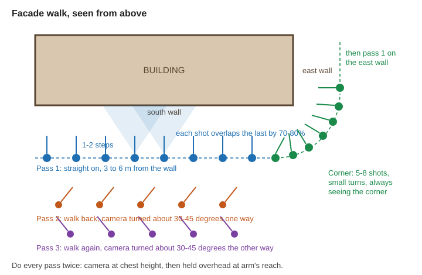

# How to photograph a facade

A facade is one side of a building. The computer finds the same small
spots (a brick corner, a window edge) in many photos and works out where
each photo was taken. It needs lots of overlap and no surprises.

## Before the first shot

- Lens clean, settings checked, 1x lens.
- **Gray card first frame:** hold the card flat, in the same light as the
  wall, and take one photo.
- Lock exposure and focus on the wall (not the sky).

## Distance

- Stand **3 to 6 m** from the wall. The photo should show the wall plus a
  strip of ground at the bottom.
- Tall building: also do one pass from farther back (10 to 15 m, or across
  the lawn) so the top floors and roof edge are in frame.
- Keep the same distance for the whole pass.

## Overlap: "one or two steps"

Each photo should share about 70 to 80% of what the last one showed.
In practice: **take a photo, move one or two steps sideways, take the
next.** Closer to the wall = smaller steps. Never turn on the spot and
shoot; always move your feet between shots.

## The passes

1. **Straight on:** walk the full length of the wall, phone pointing
   square at it.
2. **Angled one way:** walk back, phone turned about 30 to 45 degrees.
3. **Angled the other way:** walk again, turned the opposite way.

Do the passes at **two heights**: phone at **chest height**, then again
held **overhead at arm's reach** (use the volume button to shoot). The
overhead pass sees window sills, ledges and the tops of steps.

## Corners

- Turn corners **slowly**: **5 to 8 shots** while walking around the
  corner in an arc, turning the phone a little each time.
- Keep the corner itself in every one of those shots.
- Then start pass 1 on the next wall. The corner photos tie the two walls
  together.

## Connect everything

- Include some **ground** (path, curb, grass edge) in most shots. That
  ties the building to the terrain.
- Between buildings, take a short line of photos along the path (one shot
  every few steps) so facades link to each other.
- Start and end each building at the same spot if you can (a "loop").

## Close-ups (hero buildings only)

Hero buildings are on the hero list (for example Kirkland Hall). After the
normal passes:
- Doors, windows, columns, trim and carvings: a slow arc of **10 to 20
  shots** per feature, from about 1 to 2 m away.
- Then step back and take 3 to 4 shots that show the close-up area plus
  the wall around it, so the close-ups link to the big set.

## Avoid

- **Moving cars and buses** in front of the wall. Wait.
- **People filling the frame.** Wait for them to pass. A person small in
  the distance is fine.
- **Shooting into the sun.** Keep the sun behind you or to the side, or
  come back when that side is in shade.
- **Reflections:** windows and wet surfaces mirror the sky. Shoot glass
  at an angle, and include the window frame.
- **Zooming, tapping the screen mid-pass, or switching lenses.**
- **Blur:** hold still for each shot. In dim light, stop walking for each
  photo.
