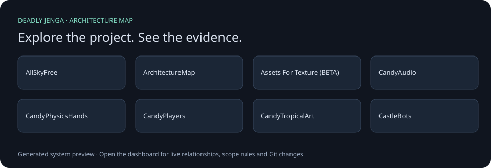

# DeadlyJenga

## Architecture Map

Double-click **Open Architecture Map.cmd** to explore the real project, inspect dependencies, and mark work as Editable, Protected, or Watch. Requires the free .NET 10 SDK; no AI service or subscription is used.

[Quick guide and limitations](Tools/ArchitectureMap/README.md) · [GitHub architecture reports](https://github.com/Vanderbilt-VR-2026/DeadlyJenga/actions/workflows/architecture-map.yml). Reports become available after the tooling is merged into the default branch. Public hosting is opt-in.

| Team Member | Major(s) | Skills / Interests | Responsibilities |
|-------------|----------|--------------------|------------------|
| Evan | Neuroscience & CS | Brain-Visual Symmetry / Cohesion | User Controls Movement Appearance |
| Kaleb | CS | Architecture | Physics Runtime Latency |
| Luke | CS | Online Social Cohesion | Networking Map State |
| Arsema | Cognitive Studies | Graphic Design | Textures Diegetic Elements |

A multiplayer VR project targeting Meta Quest. The current starting scene is `Assets/Scenes/Lobby.unity`.

See [Project context](PROJECT_CONTEXT.md) for the proposed goals, gameplay, and scope. That document describes the design proposal, not a list of implemented features.

## Sprint 1

You can find the Sprint 1 APK file [here](https://github.com/Vanderbilt-VR-2026/DeadlyJenga/releases/tag/apk).

You can find the Sprint 1 demo video [here](https://drive.google.com/file/d/1HR0qD9z5CBEIZOIg0QKBuOKLeSdWk1jh/view?usp=sharing).

## Sprint 2

All Sprint 2 deliverables are available in the [**Sprint 2 Explanation Folder**](https://drive.google.com/drive/folders/1aqJDwO-LhcusEajRKALIoX2oDCbFFBj_?usp=sharing). They contain the following:

### 1. APK File

Downloadable Meta Quest application build.

### 2. Demo Video

Video demonstration of Sprint 2 gameplay and features.

### 3. Sprint 2 Explanation & Future Directions

Detailed documentation covering the current project and planned development.

#### Feature Summary

**Environment & World Design**

- Castle-like structure with dynamic tower design
- Sand island surrounded by ocean with daytime skybox
- Shiny, candy-like art style for objects and map

**Multiplayer & AI**

- Easy networking, joining, and inviting for users running the APK on the same Wi-Fi
- AI player bots
- AI flying hand bots

**Player Avatar**

- Complete avatar visible to the user and other players
- Hand synchronization compatibility

**Movement & Interaction**

- **Climbing**
  - Stamina bar to prevent mount abuse
- **Vaulting**
  - Shooter-style ledge climbing
- Basic jumping and walking

**Demo Controls & UI**

- Add AI players and flying hands
- Reset the map without restarting the application

**Audio System**

- Block collision and scraping sounds
- Player sounds
- Ambient music and environmental audio
